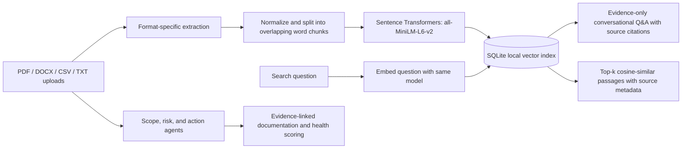

# Architecture

## Pipeline

## Components

- `document_loader.py` extracts text from each supported format. PDF pages,
  DOCX paragraphs and tables, and CSV rows are included in the extracted content.
- `rag_pipeline.py` normalizes and chunks extracted text, then stores each chunk
  and its float32 embedding in a local SQLite database. Search compares a
  normalized query embedding with indexed vectors using cosine similarity. It
  also persists content hashes and evidence-linked analyses for each processed
  source.
- `app.py` launches the Streamlit interface implemented in `ui.py`. The
  interface provides dark-themed sidebar navigation for Dashboard, Document
  intelligence, Project analysis agents, Risk analysis, Project health,
  Documentation generator, AI project assistant, and Settings. Dashboard
  metrics, charts, recommendations, risks, and source citations use the
  persisted document analyses and local vector index. New and changed PDF,
  DOCX, CSV, and TXT uploads are automatically extracted, analyzed, chunked,
  embedded, and indexed. SHA-256 content hashes skip unchanged files; changed
  files with the same name replace their prior chunks and analysis without
  removing other sources. The analysis page also supports explicitly
  re-analyzing the currently selected uploads. Indexing uses standard fixed
  chunking of 300 words per chunk with 50 words of overlap. The embedding
  model and vector store are cached for the lifetime of the Streamlit process.
- `document_ingestion.py` coordinates incremental extraction, analysis,
  chunking, and embedding. A file's chunks, content hash, and evidence-linked
  analysis are committed together, so failed processing leaves its previous
  indexed version intact. Per-file failures are reported in the interface.
- `project_agents.py` applies transparent text rules to extracted documents to
  identify scope, deliverables, milestones, dates, owners, schedule-risk
  signals, blockers, pending decisions, and action items. Risk and blocker
  scoring requires explicit status wording or a labeled finding rather than a
  general mention of those topics. Findings include source text as evidence.
  Delivery labels are risk signals only, not promises or predictions of a
  specific delivery date. Documentation generation turns
  explicit goals and deliverables into evidence-linked user-story templates
  and collects the extracted risks and actions. Health scoring averages three
  dimensions: scope clarity (25 points each for a documented goal, deliverable,
  milestone, and timeline), timeline risk (minus 30 per high and 15 per medium
  risk signal), and blockers (minus 25 per explicit blocker). Scores are
  clamped to 0–100 where applicable and are not predictions of project success.
- `answer_project_question` in `rag_pipeline.py` presents up to three retrieved
  passages with filename and chunk citations when similarity is at least 0.25.
  It uses extractive, evidence-only responses rather than an LLM, and declines
  to answer if no passage meets the threshold. This avoids unsupported claims;
  relevance is limited by the embedding model and retrieval ranking.
- `.data/project_knowledge_base.sqlite3` is created on the machine running the
  app and persists the index and analyses across restarts. Uploaded source
  documents are not copied into the database; extracted passages, embeddings,
  content hashes, and analysis JSON are stored.
- The dashboard deliberately reports project progress and task completion as
  untracked because the current agents do not classify completed actions or
  milestone status. The risk agents emit high and medium text signals only;
  they do not estimate probability, impact, critical/low severity, or a risk
  heatmap. Historical health scores are not persisted. Recent activity
  timestamps are limited to the current Streamlit session.

## Data model

Each indexed chunk has a source filename, zero-based position within that
source, extracted text, and a float32 embedding blob. Re-indexing a filename
replaces that file's previous chunks. Each processed document also has a
SHA-256 content hash and serialized analysis keyed by its source filename. The
query and indexed documents must use the same embedding model and vector
dimension.

## Run and verify

Install dependencies with `python -m pip install -r requirements.txt`, then run
`streamlit run app.py`. The first indexing or search operation downloads the
configured sentence-transformer model if it is not already cached.

Run the tests with `python -m unittest discover -s tests -v`. They cover PDF,
DOCX, CSV, and TXT extraction, analysis, indexing, documentation generation,
and evidence-cited Q&A, along with chunk boundaries and overlap, invalid
parameters, persistence, content-hash skipping, changed-source replacement,
and similarity ranking. The vector-store and ingestion workflow tests use
fixed vectors and do not need a model download.

### Milestone 4 operation

Select one or more files in the sidebar. As soon as Streamlit receives an
upload, new or modified file contents are processed automatically; selecting
the same file again does not re-embed unchanged content. Uploading updated
meeting notes under an existing filename replaces that source's prior
searchable chunks and analysis while retaining all other indexed documents.
The Project analysis page's **Re-analyze selected uploads** action forces a
refresh when needed. Dashboard health, scope, risks, actions, and generated
reports use the latest persisted analyses.

Pre-existing vector-index sources created before content hashes and persisted
analyses were introduced remain searchable. To add them to the new persistent
analysis summary, re-upload those source files.

## Analysis limitations

The analysis agents use keyword and date-pattern rules rather than an external
LLM. They report only lines that match explicit cues, preserve the matching
text as evidence, and can miss information phrased differently. The risk
forecast is a qualitative signal; it does not calculate a delivery date from
an assumed schedule.
